<strong>Computer Science & Engineering | VIT Bhopal University</strong> 
Artificial Intelligence · Machine Learning · Computer Vision · Software Engineering

<!-- Animated terminal-style identity card with live public GitHub stats and a capybara-themed contribution panel -->

✨ currently in my builder era · powered by caffeine, curiosity & commits

<picture>
  <source media="(prefers-color-scheme: dark)" srcset="https://raw.githubusercontent.com/IshanRai0506/ISHANRAI0506/main/dist/pet.svg">
  <source media="(prefers-color-scheme: light)" srcset="https://raw.githubusercontent.com/IshanRai0506/ISHANRAI0506/main/dist/pet-light.svg">
  
</picture>

---

## 🧠 About Me

Hey! I'm **Ishan Rai** — a CSE student in my **builder era**. I like turning random ideas into real projects with AI, computer vision and software engineering. Basically: less "one day I'll build it", more `git commit`.

- 🔭 Exploring **AI/ML, computer vision and intelligent applications**
- ⚽ Built **PlayVision**, an AI-powered football analytics project
- 🌱 Learning **deep learning, model deployment and system design**
- 🤝 Open to meaningful AI/ML and software development collaborations
- 💬 Ask me about **Python, Java, YOLO, OpenCV, machine learning and React**

## 🧃 Developer Lore

| Status | Current lore |
|---|---|
| 🎮 **Main quest** | Build useful things that solve real problems |
| 🧩 **Side quests** | AI experiments, football analytics & developer tools |
| 🧰 **Loadout** | Python · Java · TypeScript · PyTorch · OpenCV |
| 🐛 **Final boss** | The bug that disappears when I add `print()` |
| 🚀 **Default loop** | Build → Break → Debug → Learn → Ship |

> *I don't always push first try. But when I do, CI finds a way.*

  
  
  

---

## 🚀 Tech Stack

### 💻 Programming Languages

### 🧠 AI, ML & Computer Vision

### 🌐 Web Development

### ☁️ Cloud, Databases & Developer Tools

### 🎨 Design

---

## 🏆 Featured Projects

**[PlayVision · AI Football Analytics](https://github.com/IshanRai0506/PlayVision_Football_Stats_Tracker)**

Computer vision for player and ball tracking, team identification, pitch mapping and tactical metrics.

 

**[Viksit · Intelligent Document Redaction](https://github.com/IshanRai0506/Viksit-Intelligent-Document-Redaction)**

A privacy-focused document workflow combining OCR, NER and object detection.

 

**[OsBridgeLCCA · Bridge Life-Cycle Cost Assessment](https://github.com/IshanRai0506/OsBridgeLCCAcustom)**

Engineering tools for cost analysis, traffic, emissions and reporting.

 

**[AeroGest · Gesture Control](https://github.com/IshanRai0506/AeroGest)**

Webcam-based gesture interaction for mouse, volume and brightness controls.

 

**[Structural Beam Analysis Report Generator](https://github.com/IshanRai0506/PyLateX-Report--FOSSEE)**

Automated engineering PDF reports with shear-force and bending-moment diagrams.

---

## 📊 GitHub Analytics

  

  

---

## 🐍 Contribution Activity

---

## 🌐 Connect With Me

---

## 🎧 Spotify · Now Playing

---

## 📄 Resume

---

*“First, solve the problem. Then, write the code.”*

**Keep learning. Keep building. Keep shipping.** 🚀

⭐ If you find my projects interesting, consider giving them a star!

<a href="https://github.com/IshanRai0506">Ishan Rai · GitHub</a>

